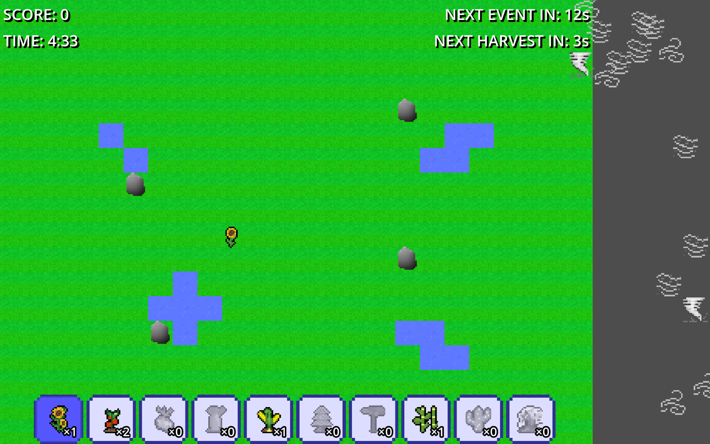

# Plant

A 2D strategy game for the browser or desktop: plant crops and defenders on a small map and keep at least one plant alive for five minutes while weather events hit it.



**Live demo:** coming soon

## Why it is useful

- It is a finished, playable Godot 4 project built in one weekend, with the full game loop (menu, play, win or lose).
- The browser build runs from a static host, so it can be tried without installing anything.

## Features

- 10 plant types in two classes: producers (sunflower, tomato, potato, carrot, corn, bamboo) that grow in stages and raise your score, and defenders (white pine, cactus, tropical tree, sakura) with higher health.
- Plants grow only with enough water tiles nearby, and lose health or growth stages when they do not get it.
- Five random events: volcano, flooding, tornado, meteorite and storm. Events become more frequent as the game goes on.
- A harvest every 5 seconds gives a random seed and adds to the score.
- Hover over a plant or inventory slot to see its stats.
- Win by surviving the 5-minute timer with a living plant. Lose when all plants die.

## How to play

Text from the in-game tutorial and the controls in `scenes/game_state.gd`:

- Choose **PLAY!** on the main menu. The game starts when you place your first seed.
- Click an inventory slot at the bottom, then press and hold the left mouse button on a free grass tile to plant. Water and rock tiles cannot be planted on.
- Press **Esc** to cancel a placement.
- Hover over a plant for more info.
- Harvests give you a random seed and score. Producers give more harvest. Defenders protect your other plants.
- Disasters hit at intervals. You lose when all your plants die.

## How it works

- `scenes/mainmenu.tscn` loads `scenes/grass_map.tscn` (the map, a `TileMapLayer` for terrain and a second for water and rocks).
- `scenes/game_state.gd` handles the inventory, placement, hover info and the end screen.
- `scenes/game_loop.gd` runs the timer, harvests and random events, and emits `game_over`.
- `plants/base_plant.gd` is the base class. `producer_plant.gd` and `defender_plant.gd` extend it, and each plant type overrides stats such as growth time, water use and health.
- `entities/` holds the weather objects (tornado, wind gust, volcano projectile, rain).

## Tech stack

- Engine: Godot 4.5, GDScript (about 1,300 lines), Compatibility renderer.
- Web export: Godot Web template, single-threaded.
- CI/CD: GitHub Actions builds the Web export and deploys it to GitHub Pages.

## Run locally

Desktop: open the folder in Godot 4.5 and press Play.

Web build (needs Godot 4.5 and its export templates installed):

```
mkdir -p build/web
godot --headless --export-release "Web" build/web/index.html
cd build/web && python3 -m http.server 8000
```

Then open http://localhost:8000.

## Tests

There are no automated tests. The CI workflow checks that the project imports and the Web export succeeds.

## Team and my role

Built at the GUTS hackathon (October 2025) by a team of four plus me:

- [Aunarky](https://github.com/Aunarky): project setup, main scene, inventory and placement.
- kailo9: plant classes and stats, difficulty, timers and tutorial text.
- 3kate90 (Kate Mykytenko): art, effects and main menu.
- yehorm14 (Yehor Mykhailov): plant balancing and plant descriptions.

The original team repository is [Aunarky/hackathon-2025](https://github.com/Aunarky/hackathon-2025). This repository is my copy. My commits changed individual plant scenes and stats (potato, carrot, cactus, sakura). Teammates later reworked some of those values.

## Limitations and next steps

- The main menu has no desert map button in the final game, and the second map was never built.
- The last merges on the original main branch dropped the game loop and weather files. This repository restores them from the last full commit.
- There are no sound effects, save data or automated tests.

## Credits / Licence

Art and code are by the team members above. No licence has been chosen yet, so all rights are reserved by the authors.
